# Mediactl
*CLI first Media Center and Home Control*

----

### Getting started
Enter the CLI `mediactl.py`:
```
python mediactl.py
```

### Commands
```
mediactl> help
  ███╗   ███╗███████╗██████╗ ██╗ █████╗  ██████╗████████╗██╗
  ████╗ ████║██╔════╝██╔══██╗██║██╔══██╗██╔════╝╚══██╔══╝██║
  ██╔████╔██║█████╗  ██║  ██║██║███████║██║        ██║   ██║
  ██║╚██╔╝██║██╔══╝  ██║  ██║██║██╔══██║██║        ██║   ██║
  ██║ ╚═╝ ██║███████╗██████╔╝██║██║  ██║╚██████╗   ██║   ███████╗
  ╚═╝     ╚═╝╚══════╝╚═════╝ ╚═╝╚═╝  ╚═╝ ╚═════╝   ╚═╝   ╚══════╝

  ──────────────────────────────────────────────────────────────
                  Media center and home control
  ──────────────────────────────────────────────────────────────

Commands:

MEDIA
  library          Local libraries, media collections, and sync
  media            Media search and metadata
  torrent          Torrent client, downloads and status
  indexer          Torrent search providers
  player           Media players

HOME
  device           Device discovery and control
  camera           Camera snapshots, streaming, and motion detection
  audio            Microphones, speech-text, noise detection, wake words
  tv               TV, apps, and remote keys
  lights           Smart light control
  ir               IR remote control
  network          Network presence, inspection, and known devices
  weather          Current conditions and forecasts

SECURITY
  security         Security control, incident management, signals
  detect           Face recognition, object detection, and quality checks

SYSTEM
  run              Run Mediactl, discovery and scheduler
  web              Mediactl web interface
  users            User accounts, access tags, and pairing
  llm              Model prompts, chat, and tool-assisted requests
  notify           Notifications and remote command listener
mediactl>
```

## Run
```text
mediactl> run
```

`run` refreshes modules' state and periodically scans the network for devices and supported services.
Discovered devices are saved in `.out/devices.json` and `.out/services.json`.
Listing the discovered devices `device list`:

```text
mediactl> device list
  camera-0             cameras      0                              -
  device-0             devices      192.168.1.1                    auto
  device-1             devices      192.168.1.38                   auto
  device-2             devices      push://127.0.0.1               127.0.0.1
  device-3             devices      push://192.168.1.37            192.168.1.37
  Ac living room       ir           xxxxxxxxxxxxxxxxxxxx           ir
  light-0              lights       xxxxxxxxxxxxxxxxxxxx           smartlife
  light-1              lights       xxxxxxxxxxxxxxxxxxxx           smartlife
  mic-0                mic          9                              -
  speaker-0            speaker      8                              -
  tv-0                 tvs          192.168.1.35                   google
  TV                   tvs          xxxxxxxxxxxxxxxxxxxx           ir
  tv-1                 tvs          100.120.216.207                webos
```

## Web UI

Start the dashboard from the interactive CLI:

```text
mediactl> web run
```

This opens the HTTPS dashboard at `https://localhost:7000`. On first use, your browser may ask you to accept the locally generated certificate.

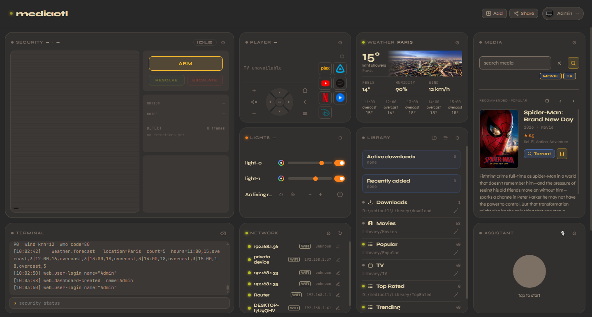

### Change the layout and theme

<table>
<tr>
<td valign="top">
<p>Open the user menu in the upper-right corner to switch between System, Media, and Browse layouts. Use Theme to change the palette; the same menu also controls full screen, editing, columns, and size.</p>
</td>
<td valign="top">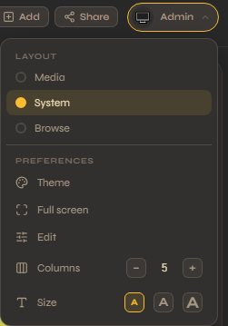</td>
</tr>
</table>

**Media layout** brings search, playback, and libraries together.

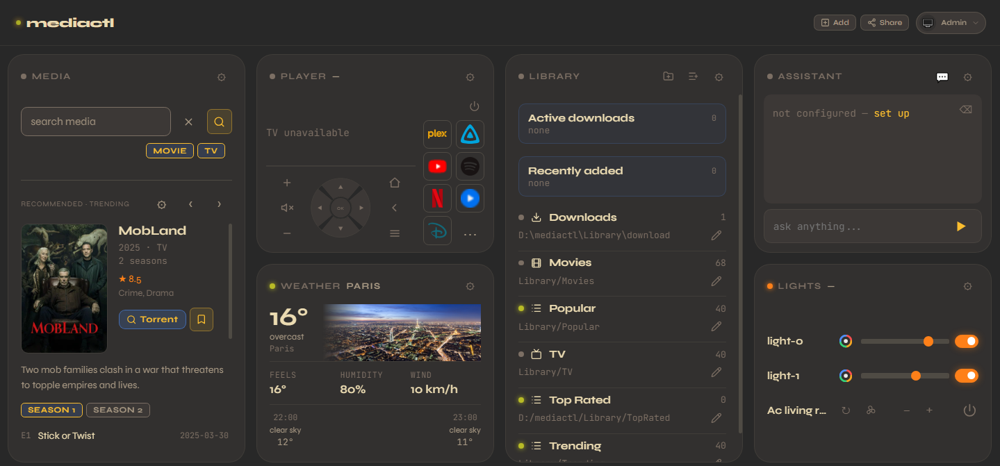

**Browse layout** shows collections as poster rows.

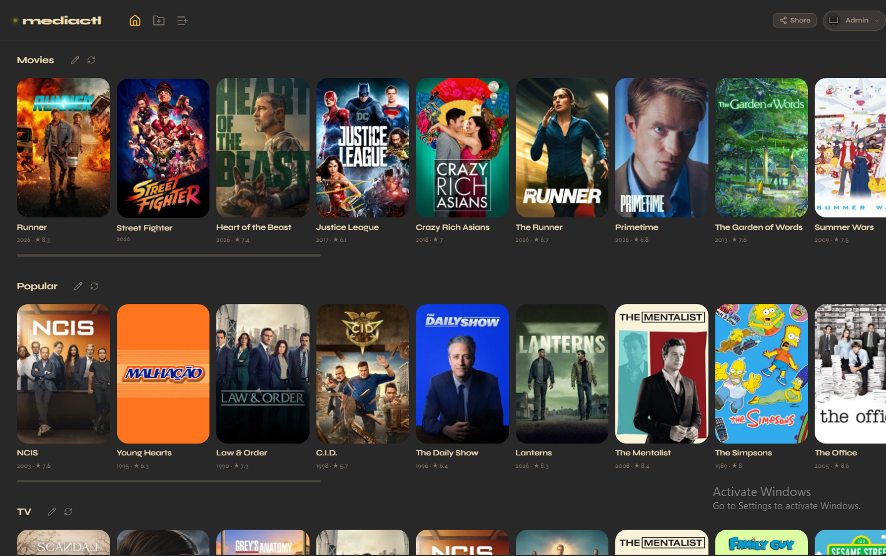

### Share with home devices and users

As an admin, click **Share** to add more home devices and users to Mediactl. Scan the QR code or enter the pairing code on another device to join. Assign user, admin, or guest access, and add the dashboard to the device's home screen for quick access.

## Media Stack

Search with Media, find torrents through built-in indexers or Prowlarr, download with qBittorrent, and play your Library through Plex or Jellyfin. A compact Sonarr/Radarr-style workflow in one dashboard and CLI.

### From discovery to playback

<table width="100%">
<tr>
<td valign="top" width="25%">
<strong>1. Set up a folder library.</strong>
<p>Use Library's folder-plus button to add existing movie or TV folders. Set metadata rules to route matching downloads into the library.</p>
</td>
<td valign="top" colspan="2"><a href="assets/library-tile.png">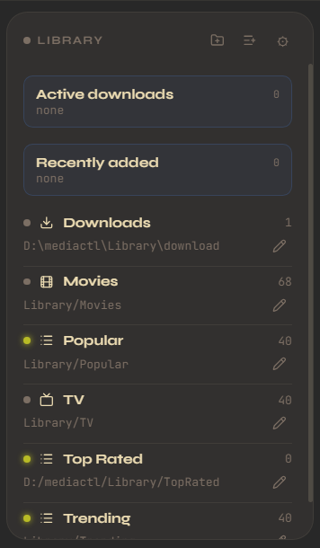</a></td>
<td valign="top" width="250"><a href="assets/library-browse.png">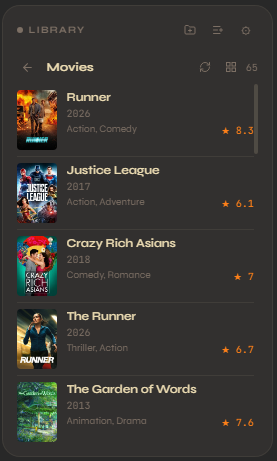</a></td>
</tr>
<tr>
<td valign="top" width="25%">
<strong>2. Set up a collection library.</strong>
<p>Use Library's list-plus button to create a collection from a preset or TMDB/Trakt list URL. Browse its titles to find media to download.</p>
</td>
<td valign="top" colspan="2"><a href="assets/add-collection.png">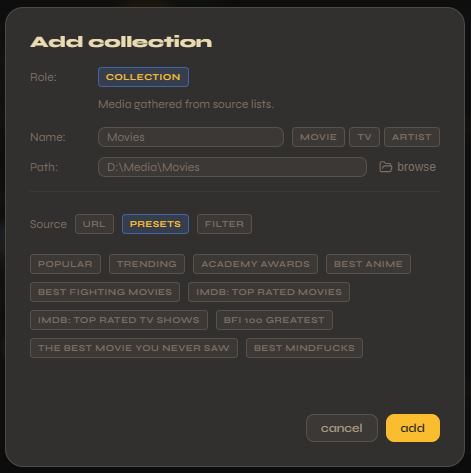</a></td>
</tr>
<tr>
<td valign="top" width="25%">
<strong>3. Search and download.</strong>
<p>Search media or collections, then click Torrent. Or add titles to Plex Watchlist or Jellyfin Favorites in their apps for automatic downloads; Media's bookmark button adds directly to Mediactl's local watchlist.</p>
</td>
<td valign="top" width="34%"><a href="assets/collection-torrent.png">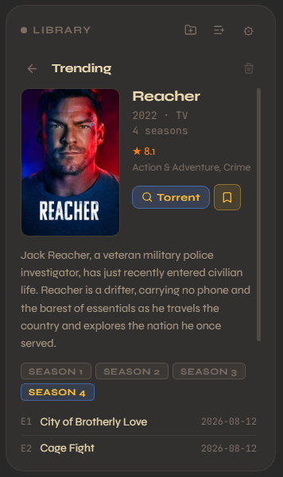</a></td>
</tr>
<tr>
<td valign="top" width="25%">
<strong>4. Play.</strong>
<p>Browse media in library, then click Play button to show in Media Center (Plex or Jellyfin).</p>
</td>
<td valign="top" colspan="2"><a href="assets/media-play.png">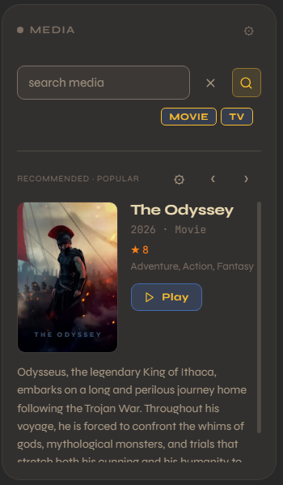</a></td>
</tr>
<tr>
<td valign="top" width="25%">
<strong>5. Player tile.</strong>
<p>The Player tile shows current app and media, and provides TV controls.</p>
</td>
<td valign="top" colspan="2"><a href="assets/player-tile.png">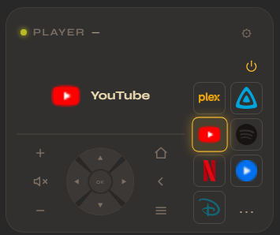</a></td>
</tr>
</table>

Sync imports completed downloads according to library rules, refreshes collection lists and missing metadata, and updates Plex or Jellyfin libraries. Player sync moves saved titles into the local watchlist; watchlist sync finds matching torrents and removes titles once queued or already in the library.

Useful CLI counterparts once the services are configured:

```text
mediactl> media search "The Matrix"
mediactl> indexer search "The Matrix 1999" --grab 1
mediactl> torrent active
mediactl> library sync-torrent
mediactl> player play-video "The Matrix"
```


## Home Stack

Monitor cameras and microphones, control smart devices, and inspect the services discovered on your network.

<table width="100%">
<tr>
<td valign="top" width="25%">
<strong>1. Monitor camera and audio.</strong>
<p>Preview a camera stream, take snapshots, and track motion. The Audio tile monitors microphone noise and provides recording and speech recognition.</p>
</td>
<td valign="top" colspan="2"><a href="assets/camera-audio-tiles.png">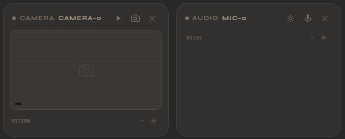</a></td>
</tr>
<tr>
<td valign="top" width="25%">
<strong>2. Control a device.</strong>
<p>Click <strong>DEVICE</strong> to choose a device and access its available controls and live status.</p>
</td>
<td valign="top" colspan="2"><a href="assets/device-tile.png">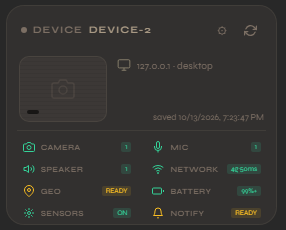</a></td>
</tr>
<tr>
<td valign="top" width="250">
<strong>3. Explore the network.</strong>
<p>Browse discovered devices and inspect the services running on each one.</p>
</td>
<td valign="top" colspan="2"><a href="assets/network-tile.png">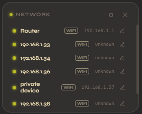</a></td>
</tr>
<tr>
<td valign="top" width="25%">
<strong>4. Group smart devices.</strong>
<p>Control Smart Life lights and IR devices. Choose what each tile displays, such as living-room bulbs and AC.</p>
</td>
<td valign="top" width="38%"><a href="assets/lights-tile.png">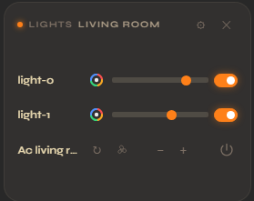</a></td>
<td valign="top" width="37%"><a href="assets/lights-selection.png">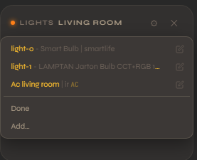</a></td>
</tr>
</table>

Useful CLI counterparts:

```text
mediactl> camera snapshot --camera camera-0
mediactl> audio listen --device mic-0
mediactl> device light-0 brightness 50
mediactl> device "Ac living room" send Power
mediactl> network scan
mediactl> tv status --tv tv-0
```


## Security

<table>
<tr>
<td valign="top">
<p>Arm Security to monitor camera motion and microphone noise. Incidents collect snapshots, object detections, and face recognition results.</p>
<p>Use <strong>Resolve</strong> to close an incident, <strong>Escalate</strong> to raise its alert level, or <strong>Disarm</strong> to stop monitoring. The gear menu controls thresholds, detectors, and notifications.</p>
</td>
<td valign="top"><a href="assets/security-tile.png">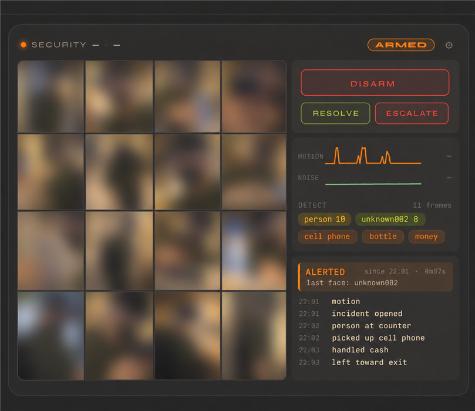</a></td>
</tr>
</table>

Motion or noise triggers incidents. Ultralytics YOLO26 detects objects; OpenCV YuNet and SFace detect and recognize faces. Enroll known faces or review unfamiliar guests.

Incident images and `detect.json` are saved in `.out/security/<session-id>/`; faces in `.out/known_faces/` and `.out/faces-unknown/`. Enable Telegram notifications for snapshots, alerts, and incident updates.


## Assistant

<table>
<tr>
<td valign="top">
<p>Use text or voice to orchestrate tasks with Mediactl operations as tools. Supports wake words and spoken replies; configure model and voice settings from the gear menu.</p>
</td>
<td valign="top"><a href="assets/assistant-tile.png">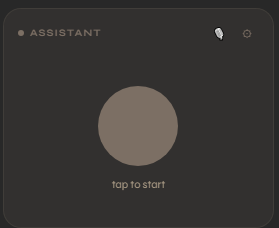</a></td>
</tr>
</table>


## Notify

<table>
<tr>
<td valign="top">
<p>Execute Mediactl commands via Telegram, receive notifications and operate the system</p>
</td>
<td valign="top"><a href="assets/notify-telegram.jpg">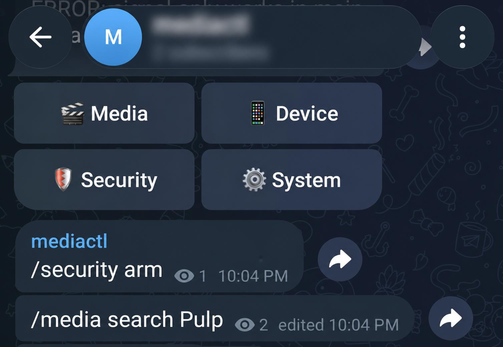</a></td>
</tr>
</table>


## Design principles
- CLI first
- Strict separation of modules
- Modules have ops that can be executed
- Ops can save state to .out and emit events
- UI can use API to execute ops, read .out state, bind to events
-
